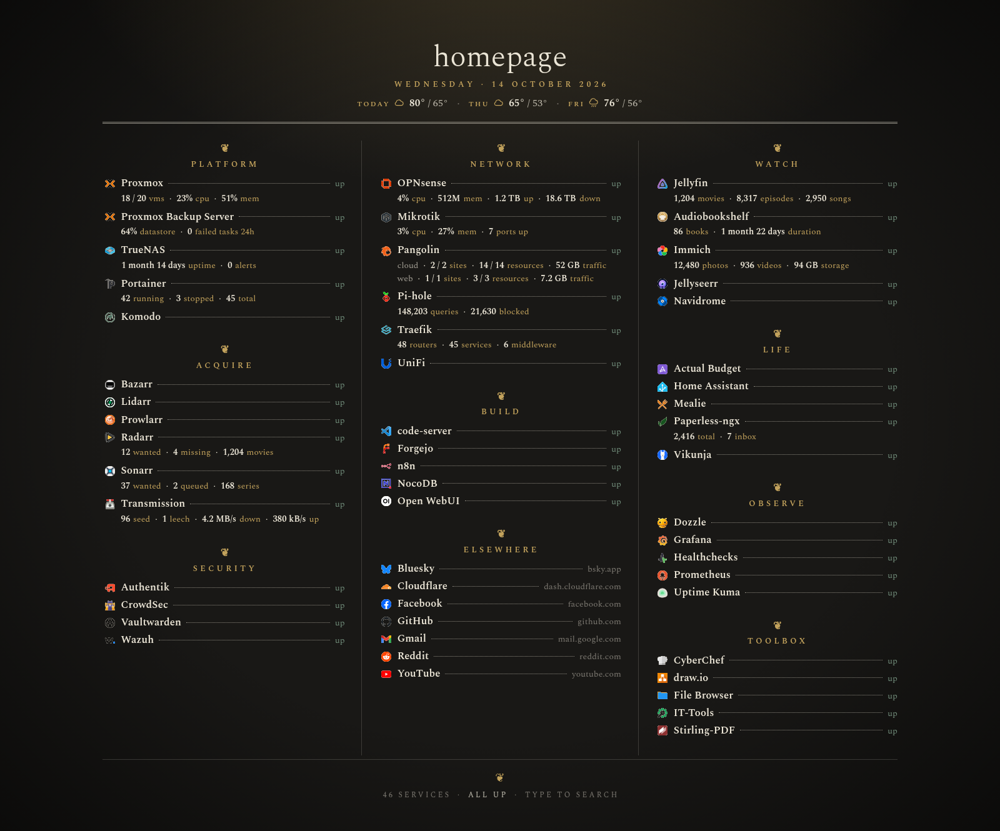

# Carte Noir

A printed-menu theme for [Homepage](https://gethomepage.dev): one page, three columns, every
service set as a line on a menu with a dotted leader to its status, and its figures underneath in
small type. Dark paper, brass accents, the Spectral typeface, a dated masthead with a three-day
weather outlook, and a closing line that tells you whether everything is up.

It is a full re-layout done in `custom.css` and `custom.js`, so it needs no fork of Homepage. There are
no image files: the lamp-glow background is CSS, and the service icons come from Homepage's icon CDN.



*The demo services with made-up figures. First shared in a
[Dashboard Wednesday thread on r/selfhosted](https://www.reddit.com/r/selfhosted/comments/1x5vaov/dashboard_wednesday_customized_homepage/).*

## How this was made

This theme was built with Claude, Anthropic's AI model (Claude Opus 5.5), working in Claude Code.
I set the direction: I asked for new layouts, picked the printed-menu design from Claude's mockups,
chose the variations, typeface and details, and tried each change on my own dashboard. Claude wrote
the code: the CSS and JavaScript, the widget configuration, the demo services and mock data, and most
of this README.

## Fork it

I built this for my own dashboard and may not update it often, so please fork it and make it your
own rather than waiting on changes here. Pull requests are welcome, but I can't promise a quick reply.

The demo widgets read their figures from `demo/mock.json` in this repository. If you change those
figures in your fork, point the `mock.json` links in `services.yaml` at your fork.

## What's here

| File | What it does |
|---|---|
| `custom.css` | The whole theme |
| `custom.js` | Masthead (date and Open-Meteo weather), closing line, spelled-out durations, sizes in GB/TB |
| `settings.yaml` | Settings the theme relies on, and the group order that makes the columns |
| `services.yaml` | 46 demonstration services across the nine sections. Runs as is with made-up figures; each widget's real configuration sits beside it as a comment |
| `demo/mock.json` | The made-up figures the demo widgets read |
| `widgets.yaml` | Empty on purpose: the masthead replaces Homepage's information widgets |
| `bookmarks.yaml` | Example "Elsewhere" bookmarks group |

Built on Homepage v2.5.0 and checked in Chromium at desktop, tablet and phone widths. It uses CSS
`:has()`, so it needs a browser from 2023 or later.

## Install

1. Copy `custom.css` and `custom.js` into your Homepage config folder (the one mounted at `/app/config`).
   Empty your `widgets.yaml` too (or use the one here), or Homepage's resource and search widgets sit
   above the title.
2. Merge these into your `settings.yaml`. The theme expects them:
   ```yaml
   theme: dark
   headerStyle: clean
   statusStyle: basic     # site monitors show as the words "up" / "down"
   disableCollapse: true  # group headings are not clickable
   ```
3. List **every** group in `layout:` in `settings.yaml`. That order fills the columns top to bottom,
   left to right. Bookmark groups can be mixed in.
4. Reload the page. Homepage picks up config changes without a restart.

## Try the demo

Drop all five YAML files plus `custom.css` and `custom.js` into an empty config folder and the page
fills with made-up figures straight away. The demo widgets read them from `demo/mock.json` in this
repository over the internet, and every status check points at Homepage itself, so everything shows
"up". To switch a service to the real thing, delete its demo widget, uncomment the "real widget" block
under it, and point its `siteMonitor` at the service.

## Make it yours

- **Title**: set `--site-title` near the top of `custom.css`.
- **Weather**: set `LAT`, `LON`, `TZ` and `UNIT` near the top of `custom.js`. Rounded coordinates
  are plenty; there is no need to publish your exact address.
- **Column heads**: on wide screens the theme starts a new column at the groups that contain the
  services named in the `break-before: column` rule (Jellyfin and OPNsense in the example). Change
  those two names to a service from the group you want at the top of the second and third columns.
- **Per-service tweaks**: a few rules near the middle of `custom.css` shorten or reorder labels for
  OPNsense, Mikrotik, Transmission and Pangolin so their figures fit on one line. They match services
  by name; rename or delete them to suit your own list.

## Figures and units

Homepage formats each widget's figures its own way, so a page can end up mixing styles. `custom.js`
tidies up the ones listed below. The list is not complete: other widgets may still show units in
Homepage's own style, and you can extend `rewriteValue()` in `custom.js` to cover them.

What is converted today, in widget figures and in the TrueNAS pool rows:

| Homepage shows | Carte shows | Rule |
|---|---|---|
| `1mo16d`, `3d 4h`, `45m` | 1 month 16 days, 3 days 4 hours, 45 minutes | Short durations spelled out: years (`y`), months (`mo`), weeks (`w`), days (`d`), hours (`h`), minutes (`m`) and seconds (`s`), singular or plural as needed |
| `38 GiB`, `1.5 MiB` | 41 GB, 1.6 MB | Binary sizes (KiB, MiB, GiB, TiB, PiB) become decimal ones (kB, MB, GB, TB, PB), matching the sizes other widgets show |
| `950 GiB` | 1 TB | A converted size of 1000 or more moves up to the next unit |
| `13.4 TiB / 21 TiB` | 14.7 TB / 23 TB | Each side of a used / total pair is converted |

A converted size keeps no more decimal places than Homepage gave it, so a whole `38 GiB` becomes a
whole `41 GB`.

Left as Homepage sends them: transfer rates (`4.2 MB/s`), memory in Homepage's short form (`512M`),
percentages, counts, and any temperature a widget reports. The weather in the masthead is fetched
in the unit set by `UNIT` in `custom.js` (Fahrenheit or Celsius), so it needs no conversion.

Separately, `custom.css` shortens some labels by position (for example OPNsense's "wan upload"
becomes "up"); see "Per-service tweaks" above.

## Credentials

The demo `services.yaml` never holds a secret. Each one is a placeholder such as
`{{HOMEPAGE_VAR_IMMICH_KEY}}`, which Homepage fills from an environment variable of the same name
(`HOMEPAGE_VAR_IMMICH_KEY=...`) set on the container. Keep your real values in an `.env` file or
your orchestrator's secrets, never in the repository.

A few of the real widget blocks take their credentials in a particular form:
- Proxmox and Proxmox Backup Server: an API token, with the token ID (`user@pam!tokenname`, or
  `user@pbs!tokenname`) as `username` and the token secret as `password`
- OPNsense: the API key as `username` and the API secret as `password`
- Pi-hole v6: an app password as `key`

## The font

Carte is set in [Spectral](https://fonts.google.com/specimen/Spectral), weights 300, 400 and 600.
There are three ways to load it; pick one.

### 1. From Google Fonts (the default, nothing to do)

The first line of `custom.css` fetches Spectral from Google Fonts whenever the page opens. The only
catch is that each viewer's browser sends a request to Google.

### 2. From your own Homepage

Homepage serves anything in a folder mounted under `/app/public`, so it can host the font itself.

Download the three weights into a `fonts` folder beside your Homepage config. These come from
[Fontsource](https://fontsource.org/fonts/spectral), under the same SIL Open Font License as Google's copy:

```bash
mkdir -p fonts && for w in 300 400 600; do curl -sLo fonts/spectral-$w.woff2 https://cdn.jsdelivr.net/npm/@fontsource/spectral@5/files/spectral-latin-$w-normal.woff2; done
```

Mount the folder by adding this under `volumes:` in your Homepage compose file, then recreate the
container:

```yaml
      - ./fonts:/app/public/fonts:ro
```

In `custom.css`, delete the `@import` line at the top and put these in its place:

```css
@font-face { font-family: 'Spectral'; font-weight: 300; font-display: swap; src: url('/fonts/spectral-300.woff2') format('woff2'); }
@font-face { font-family: 'Spectral'; font-weight: 400; font-display: swap; src: url('/fonts/spectral-400.woff2') format('woff2'); }
@font-face { font-family: 'Spectral'; font-weight: 600; font-display: swap; src: url('/fonts/spectral-600.woff2') format('woff2'); }
```

### 3. Embedded in `custom.css`

Nothing extra to host or mount, at the cost of about 90 KB added to the stylesheet. Download the
files as in option 2, then run this in your config folder to append the three rules with the font
data inside them:

```bash
for w in 300 400 600; do printf "@font-face { font-family: 'Spectral'; font-weight: %s; font-display: swap; src: url(data:font/woff2;base64,%s) format('woff2'); }\n" $w "$(base64 -w0 fonts/spectral-$w.woff2)"; done >> custom.css
```

Then delete the `@import` line at the top. On a Mac, use `base64 -i` instead of `base64 -w0`.

The downloaded files cover Latin characters only, which is all the theme displays; anything else
falls back to the browser's serif font.

## Credits

- Built with [Claude](https://www.anthropic.com/claude) (Claude Opus 5.5) by Anthropic, in Claude Code
- [Homepage](https://github.com/gethomepage/homepage)
- [Spectral](https://fonts.google.com/specimen/Spectral) by Production Type, under the SIL Open Font License
- Weather data by [Open-Meteo](https://open-meteo.com), under CC BY 4.0
